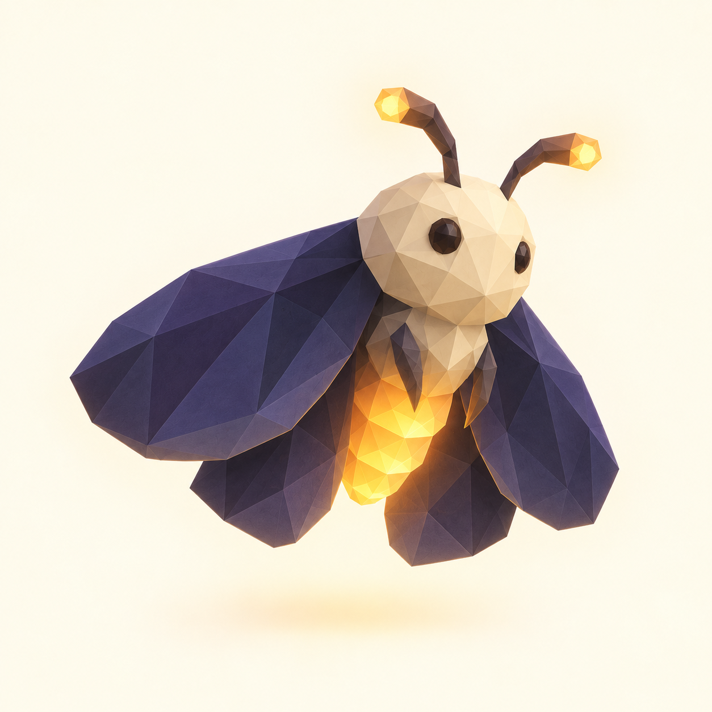
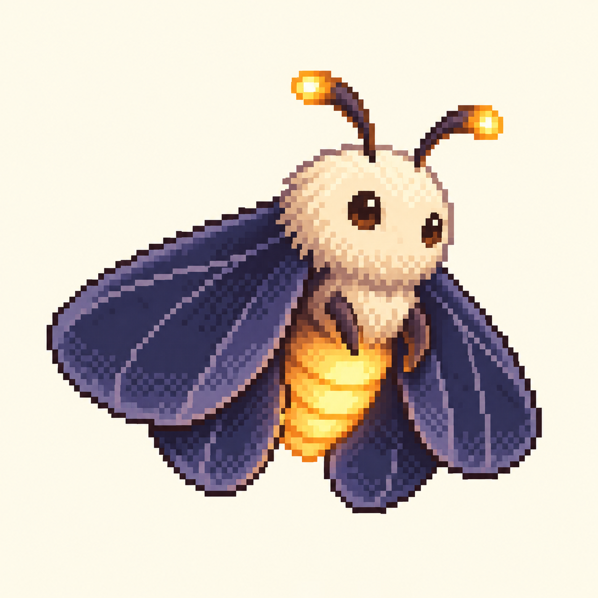
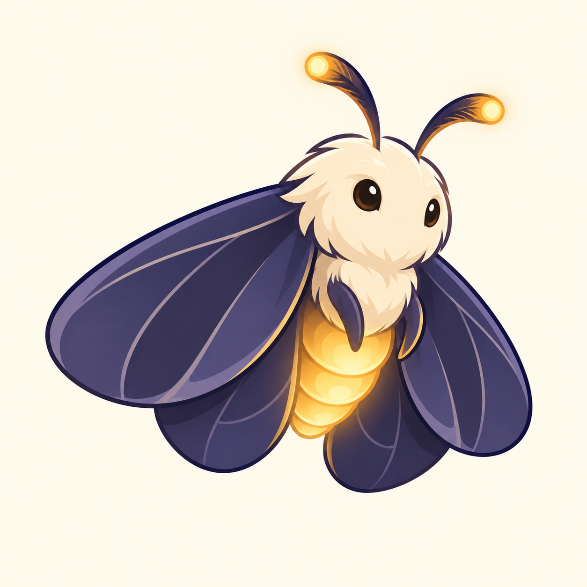
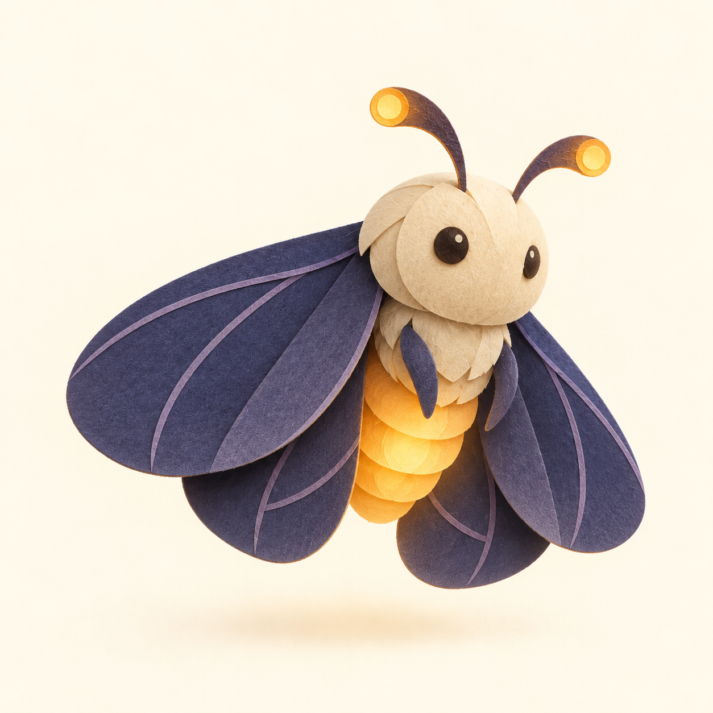
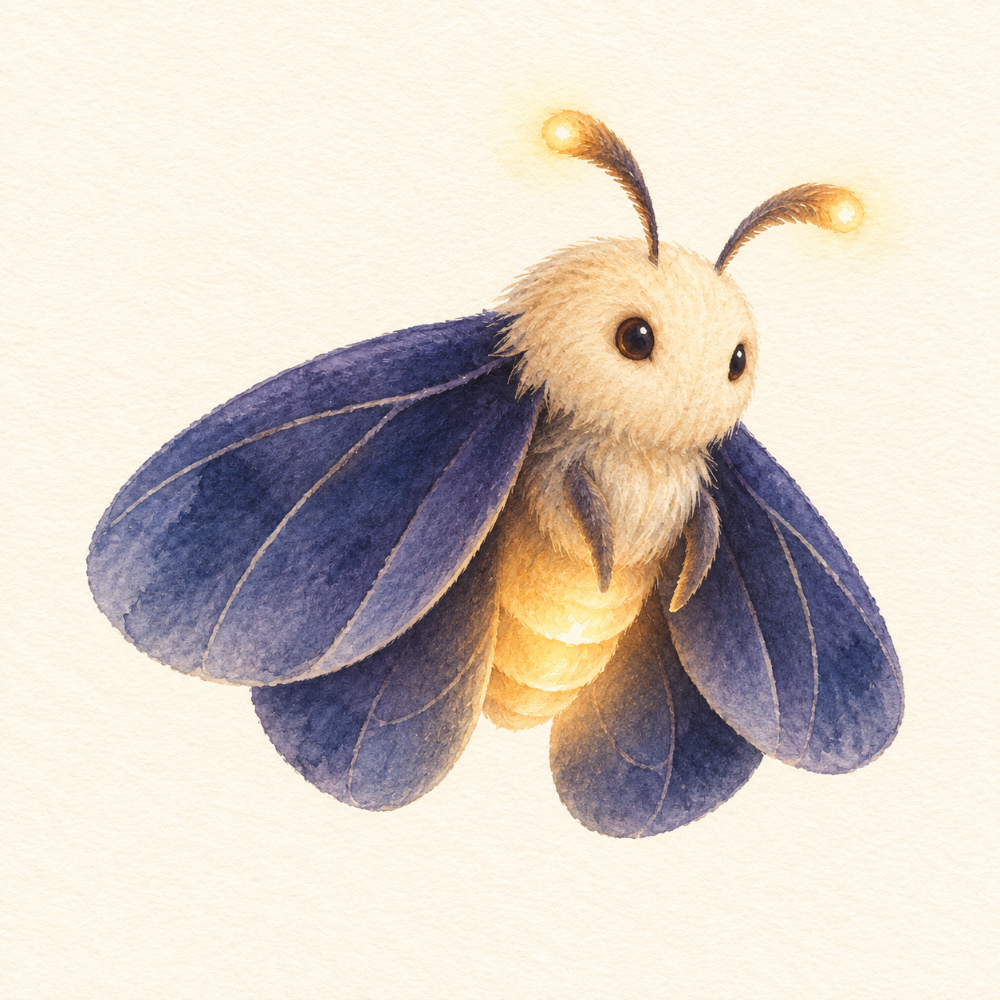

# Mote moth — five styles

Generated with the built-in image generation tool using the approved Dusk moth as the character reference.

Reference: ../brand-concepts-2026-09-21/mascot-03-dusk.png

## 01-low-poly

Prompt:

Use case: style-transfer. Use the supplied moth image as the character reference. Create ONE full-body mascot image for Mote desktop, reinterpreting this same moth in the specified medium. Preserve recognizable identity: cream round head and small thorax, two dark gentle eyes, two curved antennae with glowing amber tips, four broad overlapping indigo moth wings, warm amber segmented luminous abdomen, friendly quiet expression. Preserve its hovering three-quarter pose facing slightly right and overall proportions. Full character centered with comfortable margin, square canvas, plain warm ivory background. No text, logo, extra characters, scenery, props or collage. Make the medium unmistakably different from the reference's fuzzy 3D rendering. Style: Low-poly 3D game character. All surfaces constructed from large visible flat triangular polygon facets, angular wing edges, geometric faceted cream head, simple obsidian polygon eyes, segmented angular antennae. Matte flat-shaded indigo and cream surfaces, amber emissive abdomen with restrained glow. No fur, smooth subdivision or photoreal texture. Charming deliberately economical polygon modeling, beautiful studio lighting.

## 02-pixel-art

Prompt:

Use case: style-transfer. Use the supplied moth image as the character reference. Create ONE full-body mascot image for Mote desktop, reinterpreting this same moth in the specified medium. Preserve recognizable identity: cream round head and small thorax, two dark gentle eyes, two curved antennae with glowing amber tips, four broad overlapping indigo moth wings, warm amber segmented luminous abdomen, friendly quiet expression. Preserve its hovering three-quarter pose facing slightly right and overall proportions. Full character centered with comfortable margin, square canvas, plain warm ivory background. No text, logo, extra characters, scenery, props or collage. Make the medium unmistakably different from the reference's fuzzy 3D rendering. Style: Authentic hand-placed 2D pixel art as if built on a 96x96 pixel sprite grid and enlarged with nearest-neighbor. Clear chunky square pixels and stepped silhouettes, tightly limited palette of indigo, lavender shadow, cream, amber and dark brown; selective dark outline, careful pixel clusters and sparse dithering. Depict luminous areas using bands of amber pixels, no blurred glow or smooth gradients. No anti-aliasing, 3D or tiny high resolution detail. Entire canvas uses the same coarse pixel grid; crisp expressive desktop game sprite.

## 03-cel-shaded

Prompt:

Use case: style-transfer. Use the supplied moth image as the character reference. Create ONE full-body mascot image for Mote desktop, reinterpreting this same moth in the specified medium. Preserve recognizable identity: cream round head and small thorax, two dark gentle eyes, two curved antennae with glowing amber tips, four broad overlapping indigo moth wings, warm amber segmented luminous abdomen, friendly quiet expression. Preserve its hovering three-quarter pose facing slightly right and overall proportions. Full character centered with comfortable margin, square canvas, plain warm ivory background. No text, logo, extra characters, scenery, props or collage. Make the medium unmistakably different from the reference's fuzzy 3D rendering. Style: Expressive stylized 2D cartoon mascot with bold clean variable-width dark indigo outlines, simplified broad wing shapes, graphic two-tone cel shading, a compact cream fluffy head represented with only a few contour tufts, little glossy dark eyes, graceful antennae. Warm charming premium animation character design, strong readable silhouette, deliberately flat shapes, amber light represented graphically. No realistic fur, 3D rendering, airbrush texture or excessive detail.

## 04-paper-cutout

Prompt:

Use case: style-transfer. Use the supplied moth image as the character reference. Create ONE full-body mascot image for Mote desktop, reinterpreting this same moth in the specified medium. Preserve recognizable identity: cream round head and small thorax, two dark gentle eyes, two curved antennae with glowing amber tips, four broad overlapping indigo moth wings, warm amber segmented luminous abdomen, friendly quiet expression. Preserve its hovering three-quarter pose facing slightly right and overall proportions. Full character centered with comfortable margin, square canvas, plain warm ivory background. No text, logo, extra characters, scenery, props or collage. Make the medium unmistakably different from the reference's fuzzy 3D rendering. Style: Handcrafted layered paper cutout sculpture photographed front-three-quarter. Broad indigo wings built from overlapping thick colored cardstock with subtle lavender paper vein strips; cream head built from rounded paper pieces, tiny dark paper eye discs, curved thin paper antenna strips ending in amber circles, accordion layered amber abdomen. Visible cut edges and restrained fibrous paper texture, delicate contact shadows between layers, soft studio light. The moth appears gently hovering as a lightweight paper mobile, without strings. No fuzzy fur or plastic.

## 05-watercolor

Prompt:

Use case: style-transfer. Use the supplied moth image as the character reference. Create ONE full-body mascot image for Mote desktop, reinterpreting this same moth in the specified medium. Preserve recognizable identity: cream round head and small thorax, two dark gentle eyes, two curved antennae with glowing amber tips, four broad overlapping indigo moth wings, warm amber segmented luminous abdomen, friendly quiet expression. Preserve its hovering three-quarter pose facing slightly right and overall proportions. Full character centered with comfortable margin, square canvas, plain warm ivory background. No text, logo, extra characters, scenery, props or collage. Make the medium unmistakably different from the reference's fuzzy 3D rendering. Style: Delicate expressive watercolor and colored-pencil children's-book editorial illustration. Transparent indigo pigment washes and soft pooling on the broad wings, cream head mostly luminous paper with warm ochre washes, tiny ink eyes, fine graceful antennae, honey-gold abdomen with reserved white highlights. Subtle pencil edges and a few fine wing veins; visible cold-press paper grain, loose confident brushwork, warm understated personality. No hard vector outlines, digital 3D or photorealistic fur. Keep the silhouette coherent and recognizable.
